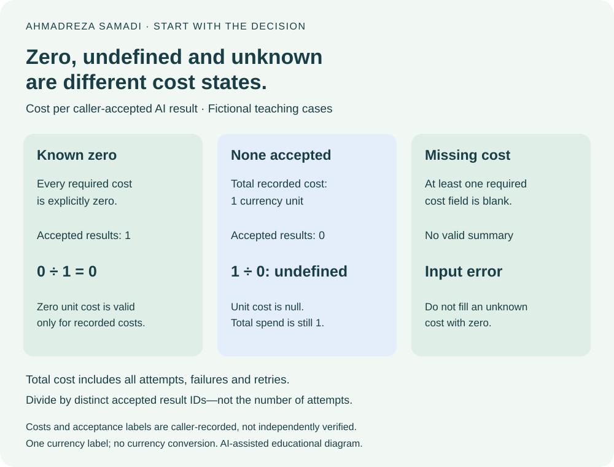
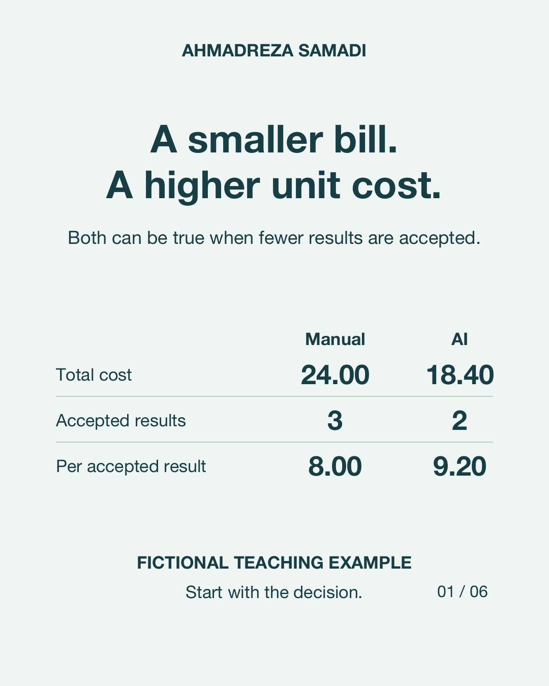

# AI workflow cost ledger

An offline, dependency-free Python CLI by [Ahmadreza Samadi](https://a-samadi.com/about.html), accompanying [AI cost per verified result](https://a-samadi.com/writing/ai-cost-per-verified-result.html).

Count what the whole attempt costs, then divide by distinct results accepted under a stated criterion. Retries and failed attempts still cost money. This utility totals your ledger; it does not decide whether a result is correct.

## Try the fictional example

Python 3.10 or newer; no install, account, API key or network connection required.

```sh
python3 workflow_cost.py examples/fictional-attempts.csv --task "Fictional property-record review" --criterion "Fictional reviewer accepts supported identity and dated evidence" --currency USD
python3 -B -m unittest discover -s tests -v
```

The invented fixture has **3 attempts across 2 results, 1 accepted result and 0.85 total cost** in the selected currency label. The cost per accepted result is 0.85. These are teaching numbers, not Appraiva measurements, customer results or a model benchmark.

If your own ledger is rejected, use the [input-error guide](docs/input-errors.md) to reconcile missing costs, duplicated attempts, attempts recorded after acceptance and unmatched result IDs in the optional comparison. A valid run with no accepted results is a separate condition; it is not a zero-cost result.

## Plan a manual-versus-AI experiment without Python

[Download the AI workflow experiment workbook](https://github.com/ahmadreza-smdi/ai-workflow-cost/releases/download/v0.1.1/AI-Workflow-Experiment.xlsx) or open its [versioned source file](examples/AI-Workflow-Experiment.xlsx).

This companion adds a paired-results worksheet and a full attempt ledger. Define one task, batch, period, currency and acceptance rule, then record each workflow's final outcome for each result. Include every retry and failed attempt. Editable labor minutes and hourly rates produce labor costs; model, tool and other non-labor costs are separate inputs. Do not enter the same labor cost again under other costs.

The three sheets are `Compare`, `Results` and `Attempts`. Amber cells are inputs; white numeric cells contain formulas. The template holds **10 paired results and 30 attempts**. Replace all fictional rows for a real experiment and stay within the labelled ranges. Save a local copy rather than adding private records to the public repository.

Use the [workbook starting guide](docs/workbook-start.md) for exact input-cell ranges, the three-sheet workflow and the fictional cost-per-accepted-result comparison. It also distinguishes the workbook layout from the CLI CSV contract.

The worked example is entirely fictional. Manual review costs 24 currency units for three accepted results, or 8 each. The AI workflow costs 18.40 for two accepted results and one rejected result, or 9.20 per accepted result. The AI batch is cheaper in total but has fewer accepted results. These are arithmetic teaching examples, not measured productivity, company performance or a recommendation to choose either workflow.

Read accepted share and pending outcomes beside cost. Labor effort and elapsed time have separate fields. The sum of per-result elapsed times is **not** calendar duration for a parallel batch. Results marked pending have unknown final elapsed time. Missing costs, invalid numbers, unmatched IDs and duplicate result/attempt IDs make dependent totals unavailable. Explicit zero stays zero; zero accepted results give undefined unit cost (`n.a.`). "Recorded batch complete" checks recorded inputs only; it does not certify experimental fairness or output correctness.

Workbook formulas passed 20 synthetic calculation/input-change checks, and the three sheets were visually reviewed. Exported formula definitions and cached values were inspected. Excel desktop and Google Sheets native recalculation were not tested. The workbook has no macros or external-workbook links. It is developed with AI assistance and covered by this repository's MIT licence. The CLI interface is unchanged in v0.1.1.

## Work through three counting cases

[Download the standalone worked-example ZIP](https://github.com/ahmadreza-smdi/ai-workflow-cost/releases/download/v0.1.2/AI-Cost-Worked-Examples.zip), or browse the [example source folder](examples/worked-cases/). Unzip it, open `index.html` for the walkthrough and run this command from that folder:

```sh
python3 -B verify_examples.py
```

The three fictional cases distinguish failed/retried attempt costs, zero accepted results and explicitly known zero costs. Four attempts costing 1.60 currency units with two accepted results give 0.80 per accepted result. Spending 1.00 with none accepted gives an undefined unit cost (`null`), while zero recorded cost with one accepted result gives zero. A missing-cost negative control is rejected rather than treated as zero.

These separate fixtures are arithmetic examples, not a controlled comparison of workflows, models or company performance. The package includes the unchanged CLI, three CSVs, expected summaries, the walkthrough, a replay script and MIT licence. Python 3.10 or newer; no dependencies, account or network required. v0.1.2 adds documentation and examples; the CLI and existing workbook are unchanged.

## Zero, undefined and unknown

<picture>
  <source media="(max-width: 650px)" srcset="docs/cost-states-mobile.svg">
  
</picture>

The diagram separates the existing known-zero case, no-accepted-results case and missing-cost negative control. It does not compare real workflows or independently verify the caller’s costs or acceptance labels.

## Start with your own records

Copy [the blank CSV header](templates/attempt-ledger.csv) to a private working folder and complete [the experiment notes](templates/experiment-notes.txt) before recording attempts. The CSV contains no sample rows or default costs. An empty file is intentionally rejected; it is not a zero-cost experiment.

Define the intended user, destination, supported action and acceptance evidence with neutral labels in your private notes. If your criterion requires successful use at that destination, generation or delivery alone does not meet it. Include checking and rework attempts and their costs under the same result ID before marking it accepted; an accepted attempt closes that result. These prompts help you state your rule. Neither the notes nor the CLI verify destination use or the evidence behind your acceptance label.

Add one row for every attempt using the field rules below. Keep the same result ID across retries, record all known cost categories and enter zero only when it is known to be zero. Resolve unknown costs and pending decisions under your documented cutoff before a final run. Do not overwrite the fictional fixtures or commit private records to this repository.

Run from this repository folder after filling the CSV. Replace both quoted labels and the currency label with your own experiment definitions:

```sh
python3 workflow_cost.py /path/to/private/attempt-ledger.csv --task "Your task and batch" --criterion "Your explicit acceptance criterion" --currency USD
```

For comparisons, use a separate ledger per workflow with the same population, period, currency, acceptance rule and cost allocation. The notes help document choices; neither they nor the CLI certify a fair comparison, a correct result or complete cost recording. If you prefer a spreadsheet, use the workbook above and replace its fictional rows instead.

## Compare two ledgers for the same recorded results

The optional `compare_ledgers.py` companion runs the unchanged validator on two separate CSVs and requires exactly the same result IDs. It prints both summaries together, including every retry, total spend, accepted results and unit cost. It selects no winner. Educational, not financial advice. Python 3.10 or newer; no dependencies or network required.

```sh
python3 compare_ledgers.py examples/paired-ledgers/fictional-manual.csv examples/paired-ledgers/fictional-ai.csv --task "Fictional paired review" --criterion "Fictional evidence rule" --currency USD
```

These **fictional** ledgers give Manual 24 / 3 = 8.00 and AI 18.40 / 2 = 9.20 per accepted result. Lower total spend can accompany higher unit cost when fewer results are accepted. This mirrors the workbook's teaching arithmetic; it is not a workbook export, benchmark or company measurement.

For private use, replace the two CSV paths and experiment labels; optionally set `--left-label` and `--right-label`. Inputs are read once each, then validated from temporary local snapshots, which are removed on exit. Input files stay unchanged; JSON goes to stdout and errors to stderr. The report includes input hashes, not file paths or result IDs. Task, criterion and workflow labels are included: keep those labels free of private details before sharing any report. Temporary storage and reports are ordinary local files, not encrypted storage or secure deletion.

The caller must use the same actual task, period, population, acceptance rule, currency and cost allocation. Shared IDs alone do not establish those facts. Mismatched IDs or either invalid ledger cause exit 2 with no partial report. Unknown costs remain errors; no accepted results remains `null`, distinct from explicit zero unit cost. Pending is not a CLI outcome: reconcile the same documented cutoff for both workflows instead of silently dropping unmatched results. Keep private records and reports out of the public repository.

Prefer a download? [Get the offline paired-ledger kit](examples/AI-Cost-Paired-Ledgers.zip), extract the entire ZIP and open `index.html`. It contains the two existing CLIs, two fictional CSVs, 11 comparison checks and the MIT licence. Python 3.10 or newer must already be available. This is a main-branch companion, separate from the v0.1.2 worked-example ZIP; it is not a new tagged release.

Maintainers can rebuild this kit with `python3 -B examples/paired-ledgers/build_package.py`. Its seven allowlisted text files use UTF-8 and LF line endings. Tests compare logical file contents rather than requiring identical compression bytes across systems.

### Six-card visual reading guide

[Open the six-page visual guide](docs/ai-cost-reading-guide/AI-Cost-Per-Accepted-Result.pdf) or [read the text notes and source links](docs/ai-cost-reading-guide/reading-notes.txt). The fictional teaching comparison shows Manual 24 / 3 = 8.00 and AI 18.40 / 2 = 9.20 per accepted result. Read both total spend and accepted counts; a smaller total bill can have a higher unit cost. Educational, not financial advice. Prepared with AI assistance; no actual workflow experiment, company performance or ROI is claimed. These reading materials accompany the existing tool, rather than a new utility or tagged release.



## Prepare your CLI ledger

One row per attempt, in execution order within each result. Exact unique headers, in any order:

```text
result_id,attempt_id,outcome,model_cost,tool_cost,review_cost,other_cost
```

- `result_id`: one intended deliverable; keep it stable across retries. A repeated document or candidate must not become a new accepted result merely because it was retried.
- `attempt_id`: unique within its result. Different results may reuse an attempt label.
- `outcome`: `accepted`, `rejected` or `error`. An accepted row closes that result; later attempts for it are rejected as ambiguous input. Split genuinely different deliverables into different result IDs.
- All four cost columns are mandatory. Enter an explicit zero when a category is known to be zero; missing values cause failure. Use nonnegative plain decimals with at most 12 integer and 9 fractional digits. No exponent notation, thousands separators, currency symbols, NaN, infinity, rebates or negative costs. Allocate credits separately before preparing a consistent ledger.
- Price review time yourself using a stated rate and time basis; the utility invents neither wages nor effort. Put other consistently allocated experiment costs in `other_cost`. Do not count the same provider charge, tool bill or review allocation in two rows/categories.

Only combine one currency and one task/acceptance criterion in a run. `--currency` is a three-uppercase-letter **label**, not ISO validation or exchange-rate conversion. The CSV has no currency column; the caller must enforce this input contract. Use separate ledgers for workflows you want to compare. Include their failed and rejected attempts consistently and use the same population, period, acceptance rule and cost categories.

## Interpret the JSON

The numerator sums all four cost categories across every attempt. The denominator counts distinct accepted result IDs. If none is accepted, `cost_per_accepted_result` and its exact fraction are JSON `null`; total spend and zero accepted outputs remain visible. This differs from an explicitly zero-cost accepted result, whose unit cost is zero.

Amounts are decimal strings, not binary floats. Displayed unit cost rounds half up to nine decimal places; the exact numerator and denominator are also retained. Maximum 100,000 attempts per file. Empty ledgers, duplicate headers/attempts, malformed rows, unknown costs and attempts after acceptance fail with exit code 2 and no partial JSON. Successful summaries exit 0, including a run with zero accepted outputs. Usage errors go to stderr. Input bytes are not changed and output goes only to stdout/stderr.

## Limits

Acceptance is a caller-supplied label, not independent verification. This tool does not calculate precision, recall, time to decision, completeness of your cost allocation or product usefulness. Read those measures alongside cost. It cannot establish return on investment, actual property value, a company outcome or which model to buy. Pending decisions must be resolved or excluded under an explicitly documented cutoff before a final run; arbitrary exclusion can bias the comparison. No telemetry or automatic uploads.

Developed with AI assistance and synthetic CLI tests. No performed customer evaluation or independent review is claimed. Original utility code, documentation and fictional fixtures are [MIT licensed](LICENSE); this does not relicense the personal website or its other assets.

## Software metadata and attribution

[codemeta.json](codemeta.json) describes this repository and identifies Ahmadreza Samadi as its author, with the personal biography as an identity link. The metadata describes the repository without assigning a release version. For version-specific credit, use the CITATION.cff from the revision you actually used. This documentation addition does not create a new release or DOI.
